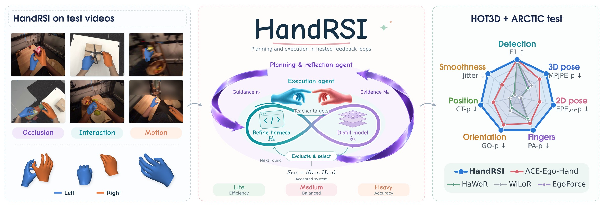
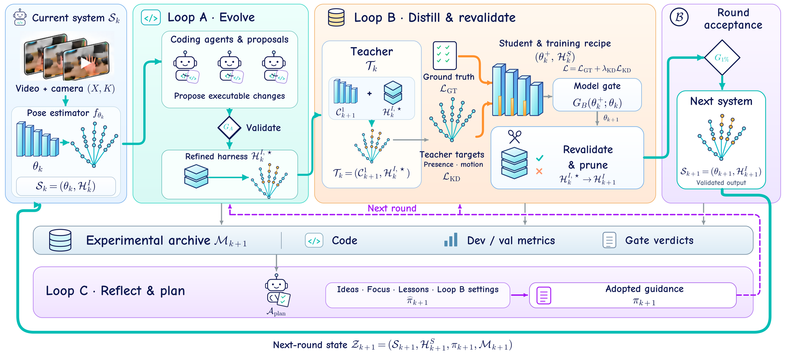

<div align="center">

# HandRSI: Recursive Self-Improvement for Hand Pose Estimation

Coding agents improve a video hand-pose network and its inference harness, round by round.

**[Weights and harnesses (Hugging Face)](https://huggingface.co/HandRSI/HandRSI)** · **Technical report: arXiv link to follow**



</div>

HandRSI starts from [ACE-Ego-Hand](https://github.com/ggxxii/ACE-Ego-Hand), a video model that recovers bimanual MANO
hands from egocentric RGB, and improves it in rounds without human-written model changes:

<div align="center">

</div>

Training and every decision of the automated RSI loop use public 3D data only: HOT3D and ARCTIC (train / dev / val).
Test splits are sealed and HOI4D is zero-shot. Evaluation follows ACE-Ego-Hand's protocol (Appendix A.1), re-implemented in `ace_eval/`.

## Results (sealed test, after 5 rounds)

HandRSI against the baselines of ACE-Ego-Hand's Table 1, all run by us on the same test splits and scored with the same
evaluator. Bold: best in the column.

**HOT3D (test, 27 recordings, 1162 segments)**

| method | FAcc ↑ | Recall ↑ | F1 ↑ | MPJPE-p ↓ | PA-p ↓ | MPJPE+OOS ↓ | EPE2D-p ↓ | GO-p ↓ | CT-p ↓ | Jitter ↓ |
|---|---|---|---|---|---|---|---|---|---|---|
| *single-frame* | | | | | | | | | | |
| HaMeR† | 0.735 | 0.890 | 0.895 | 64.51 | 10.07 | 73.03 | 64.86 | 47.78 | 0.095 | 19.47 |
| Hamba† | 0.510 | 0.739 | 0.768 | 72.79 | 9.83 | 79.84 | 169.64 | 64.16 | 0.150 | 14.73 |
| WiLoR† | 0.861 | 0.911 | 0.949 | 26.82 | 7.44 | 41.67 | 61.48 | 22.75 | 0.082 | 16.22 |
| WildHands† | 0.710 | 0.868 | 0.873 | 51.59 | 12.13 | 56.88 | 102.30 | 49.61 | 0.140 | 23.29 |
| InterWild† (egocentric checkpoint) | 0.729 | 0.885 | 0.891 | 72.16 | 11.10 | 80.78 | 69.45 | 54.14 | 0.110 | 50.93 |
| *video* | | | | | | | | | | |
| HaWoR† | 0.835 | 0.895 | 0.942 | 24.94 | 6.92 | 40.12 | 55.05 | 22.20 | 0.072 | 11.86 |
| OmniHands† | 0.583 | 0.874 | 0.819 | 61.35 | 10.35 | 63.74 | 87.27 | 49.12 | 0.215 | 327.39 ᵃ |
| EgoForce† | 0.781 | 0.858 | 0.917 | 38.52 | 7.43 | 53.01 | 88.39 | 33.99 | 0.105 | 18.34 |
| ACE-Ego-Hand K-free† | 0.922 | 0.952 | 0.961 | 17.34 | 6.38 | 13.61 | 21.20 | 12.21 | 0.045 | 2.59 |
| ACE-Ego-Hand K-given† (θ0, HandRSI's start) | 0.970 | 0.986 | 0.990 | 12.97 | 5.90 | 12.84 | 9.66 | 6.90 | 0.024 | 2.82 |
| *ours* | | | | | | | | | | |
| HandRSI network θ2 alone | **0.982** | 0.994 | **0.994** | 9.37 | 4.71 | 10.35 | 5.31 | 5.80 | **0.013** | 2.51 |
| **HandRSI: θ2 + H5\* (final)** | **0.982** | **0.996** | **0.994** | **8.37** | **4.37** | **9.70** | **4.07** | **5.16** | **0.013** | **1.34** |

**ARCTIC (test = subject s05, 291 segments)**

| method | FAcc ↑ | Recall ↑ | F1 ↑ | MPJPE-p ↓ | PA-p ↓ | MPJPE+OOS ↓ | EPE2D-p ↓ | GO-p ↓ | CT-p ↓ | Jitter ↓ |
|---|---|---|---|---|---|---|---|---|---|---|
| *single-frame* | | | | | | | | | | |
| HaMeR† | 0.869 | 0.937 | 0.955 | 29.71 | 9.94 | 37.02 | 55.53 | 25.61 | 0.096 | 17.93 |
| Hamba† | 0.766 | 0.892 | 0.909 | 33.15 | 10.14 | 39.83 | 89.84 | 30.76 | 0.119 | 15.20 |
| WiLoR† | 0.906 | 0.945 | 0.971 | 20.80 | 7.48 | 29.12 | 52.23 | 18.38 | 0.068 | 23.55 |
| WildHands† | 0.870 | 0.938 | 0.956 | 26.66 | 9.67 | 33.19 | 54.60 | 23.68 | 0.064 | 12.71 |
| InterWild† (egocentric checkpoint) | 0.865 | 0.934 | 0.953 | 31.31 | 11.34 | 38.17 | 60.18 | 26.55 | 0.092 | 39.55 |
| *video* | | | | | | | | | | |
| HaWoR† | 0.880 | 0.932 | 0.963 | 33.62 | 9.24 | 41.02 | 59.60 | 27.65 | 0.083 | 13.37 |
| OmniHands† | 0.835 | 0.964 | 0.931 | 30.52 | 10.05 | 34.91 | 40.36 | 24.29 | 0.107 | 50.83 |
| EgoForce† | 0.860 | 0.920 | 0.956 | 23.14 | 8.82 | 31.57 | 66.62 | 22.19 | 0.076 | 14.87 |
| ACE-Ego-Hand K-free† | 0.969 | 0.984 | 0.987 | 16.61 | 7.71 | 16.43 | 16.77 | 13.99 | 0.030 | 2.45 |
| ACE-Ego-Hand K-given† (θ0, HandRSI's start) | 0.986 | 0.995 | 0.996 | 15.58 | 7.43 | 16.54 | 9.36 | 12.45 | 0.024 | 2.58 |
| *ours* | | | | | | | | | | |
| HandRSI network θ2 alone | 0.987 | 0.995 | **0.997** | 15.15 | 7.28 | 16.11 | 9.12 | 12.34 | 0.021 | 2.36 |
| **HandRSI: θ2 + H5\* (final)** | **0.990** | **1.000** | **0.997** | **13.85** | **6.34** | **15.18** | **7.61** | **11.61** | **0.019** | **1.45** |

**HOI4D (zero-shot, 498 segments)**

| method | FAcc ↑ | Recall ↑ | F1 ↑ | MPJPE-p ↓ | PA-p ↓ | MPJPE+OOS ↓ | EPE2D-p ↓ | GO-p ↓ | CT-p ↓ | Jitter ↓ |
|---|---|---|---|---|---|---|---|---|---|---|
| *single-frame* | | | | | | | | | | |
| HaMeR† | 0.930 | 0.926 | 0.961 | 45.10 | 11.66 | 45.12 | 75.83 | 34.14 | 0.170 | 20.95 |
| Hamba† | 0.920 | 0.913 | 0.954 | 46.25 | 11.24 | 46.22 | 90.45 | 35.73 | 0.167 | 18.77 |
| WiLoR† | 0.978 | 0.976 | 0.988 | 34.10 | 10.37 | 34.11 | 30.59 | 25.36 | 0.105 | 16.44 |
| WildHands† | 0.930 | 0.925 | 0.961 | 44.16 | 13.96 | 44.17 | 81.98 | 46.01 | 0.152 | 18.57 |
| InterWild† (egocentric checkpoint) | 0.929 | 0.925 | 0.960 | 53.83 | 12.98 | 53.84 | 77.67 | 41.82 | 0.173 | 48.22 |
| *video* | | | | | | | | | | |
| HaWoR† | 0.985 | 0.984 | 0.991 | 33.04 | 11.43 | 32.93 | 22.73 | 25.66 | 0.063 | 16.76 |
| OmniHands† | 0.991 | 0.991 | 0.992 | 41.41 | 10.69 | 40.88 | 19.77 | 29.44 | 0.086 | 32.36 |
| EgoForce† | 0.939 | 0.935 | 0.964 | 45.64 | 11.97 | 45.86 | 106.88 | 39.50 | 0.123 | 42.03 |
| ACE-Ego-Hand K-free† | **0.996** | **0.996** | **0.997** | 23.14 | 11.14 | 22.82 | 17.42 | **18.33** | **0.050** | 2.22 |
| ACE-Ego-Hand K-given† (θ0, HandRSI's start) | 0.994 | 0.994 | 0.994 | 23.45 | 11.02 | 22.93 | **15.60** | 19.39 | 0.058 | 2.10 |
| *ours* | | | | | | | | | | |
| HandRSI network θ2 alone | 0.992 | 0.992 | 0.993 | 24.11 | 11.13 | 23.42 | 17.39 | 19.57 | 0.064 | 1.87 |
| **HandRSI: θ2 + H5\* (final)** | 0.991 | 0.991 | 0.992 | **22.77** | **10.21** | **21.93** | 18.61 | 19.44 | 0.064 | **1.01** |

† Reproduced, not quoted: official code and released weights, run under ACE-Ego-Hand's baseline protocol (Appendix A)
on our test splits and scored with `ace_eval`, our re-implementation of ACE-Ego-Hand's evaluation (none has been
released). They differ from the values in ACE-Ego-Hand's paper, whose splits are not ours. Protocol and checks:
[`baselines/README.md`](baselines/README.md).

- Rounds 3-5 did not improve the network (θ3 = θ4 = θ5 = θ2); their gains come from the harness. Round-by-round tables
  with their controls: [`results/README.md`](results/README.md).
- Beyond fine-tuning: ACE-Ego-Hand fine-tuned on the same ground truth alone (control C1₁) reaches HOT3D MPJPE-p 9.91
  and Jitter 2.77; HandRSI is 16 % and 51 % lower.
- Classical post-processing does not explain the gain: on θ2, the best val-selected Savitzky-Golay filter gives HOT3D
  MPJPE-p 9.34 and a naive WiLoR ensemble 9.32, against 8.37 for HandRSI ([`baselines/classical/`](baselines/classical/README.md)).
- HOI4D is zero-shot: 3D pose and smoothness improve, 2D accuracy and detection are slightly worse than ACE-Ego-Hand.
- Detection columns do not score predictions on hands without a ground-truth annotation (`ace_eval/README.md`).

ᵃ OmniHands' HOT3D Jitter comes from 0.17 % of hand-frames where its PnP placement diverges (z > 5 m).

## Deployment tiers

Sub-chains of the final harness, selected on val by hypervolume over the measured accuracy-speed front (technical
report, Sec. 3.5 and 5.5); the three tiers cover 98.5 % of the front's hypervolume. FPS end to end, network included,
on one RTX PRO 5000; sealed test.

| system | modules | FPS | HOT3D MPJPE-p / Jitter | ARCTIC MPJPE-p / Jitter |
|---|---|---|---|---|
| network θ2 alone | 0 | 42.7 | 9.37 / 2.51 | 15.15 / 2.36 |
| Lite | 20 | 41.1 | 9.06 / 1.47 | 14.53 / 1.58 |
| Medium | 28 | 34.0 | 9.04 / 1.33 | 14.47 / 1.45 |
| Heavy (with WiLoR) | 29 | 20.7 | 8.41 / 1.35 | 14.00 / 1.46 |
| full harness H5\* (with WiLoR) | 39 | 16.2 | 8.37 / 1.34 | 13.85 / 1.45 |

The tiers are in `rsi/harness/trees/{Lite,Medium,Heavy}`; run one with `--harness rsi/harness/trees/Lite` (see below).
Search, front and the test scores of every front point: [`results/paper/tiers.json`](results/paper/README.md).

## Models used

Loop A: 4 x Claude Opus 5.5 (Claude Code) and 4 x GPT-6-sol (Codex CLI) per round; merge agent and Loop C: Claude Opus
5.5; image evidence inside the harness: WiLoR.

## Repository

```
infer_video.py   run HandRSI (or the ACE-Ego-Hand baseline) on a video
ace_eval/        the evaluator (ACE-Ego-Hand protocol), with unit tests
baselines/       published hand estimators re-run under ACE-Ego-Hand's baseline protocol;
                 classical/ = classical post-processing and naive WiLoR ensemble controls
rsi/             the self-improvement loop: harness/ (runtime, trees/H5 = final harness, trees/Lite|Medium|Heavy =
                 deployment tiers), capture/, data/, eval/, loopA/ (agents, sandbox, gate), loopB/ (distillation),
                 loopC/ (research lead), rounds/
results/         test tables; paper/ = the result files behind the remaining tables of the technical report
```

## Requirements

1. ACE-Ego-Hand: clone [github.com/ggxxii/ACE-Ego-Hand](https://github.com/ggxxii/ACE-Ego-Hand) (commit `59da83b`)
   to `rsi/capture/ace_official` (or set `ACE_OFFICIAL`) and follow its README: its requirements, VideoX-Fun in
   `third_party/`, the Wan2.2-Fun-5B-Control backbone in `ckpt/`, the caption embedding, and its K-given checkpoint
   `ace_ego_hand_k.pt` (`ACE_CKPT`, default `rsi/checkpoints/ace_ego_hand_k.pt`).
2. `pip install -r requirements.txt`
3. MANO: the converted models from ACE-Ego-Hand's `scripts/convert_mano_pkls.py`, in `ace_eval/data/mano/` or
   `ACE_EVAL_MANO_DIR`.
4. WiLoR (used by some harness modules):
   ```bash
   pip install --no-deps --no-build-isolation chumpy==0.70
   pip install --no-deps "git+https://github.com/warmshao/WiLoR-mini@ebec42f94c389070cdd7dda6fd1bf0b4a659c960"
   ```
   and its weights under `WILOR_MINI_ROOT/wilor_mini/pretrained_models/` (default `rsi/third_party/wilor_root`). Every
   segment prints `[wilor] coverage ...` when WiLoR is at work; `[wilor] model unavailable` means it is not, and the
   results then differ from ours.

5. Data (for evaluation and the loop): [HOT3D](https://facebookresearch.github.io/hot3d/),
   [ARCTIC](https://arctic.is.tue.mpg.de/) and [HOI4D](https://hoi4d.github.io/) from their official pages; the
   splits are fixed in `rsi/data/splits/`.

All locations are listed in `rsi/rsi_paths.py`.

## Download checkpoints

Weights on Hugging Face: [HandRSI/HandRSI](https://huggingface.co/HandRSI/HandRSI), with θ1 and θ2
(= θ3 = θ4 = θ5, the final network) and the harness of every round. The weights are fine-tuned from ACE-Ego-Hand's
checkpoint and keep its CC BY-NC 4.0 licence. The final harness H5* also ships here: `rsi/harness/trees/H5`.

```bash
huggingface-cli download HandRSI/HandRSI --local-dir checkpoints/handrsi
```

## Run on a video

```bash
# HandRSI: network θ2 + harness H5*
python infer_video.py --video clip.mp4 --intrinsics fx,fy,cx,cy --ckpt checkpoints/handrsi/theta2 --out results/clip

# a deployment tier instead of the full harness
python infer_video.py --video clip.mp4 --intrinsics fx,fy,cx,cy --ckpt checkpoints/handrsi/theta2 \
    --harness rsi/harness/trees/Lite --out results/clip_lite

# the ACE-Ego-Hand baseline: released checkpoint, no harness
python infer_video.py --video clip.mp4 --camera cam.json --ckpt release --harness empty --out results/clip_ace
```

The video is processed in 81-frame segments, exactly as in the evaluation. `--camera` takes ACE-Ego-Hand's `cam.json`
format. Output: one `.npz` per video with per-frame MANO hands in the camera frame (see the docstring of
`infer_video.py`).

## Evaluate

```bash
cd rsi
python data/convert_hot3d.py --seq $RSI_DATA_RAW/HOT3D/<sequence> --out data/hot3d_ace   # per sequence; also ARCTIC, HOI4D
python data/build_views.py                       # data/views/<dataset>_<split> from data/splits/
bash capture/capture.sh <name> <ckpt dir | release> hot3d_test <gpu>                       # -> captures/<name>/hot3d_test
python -m harness.run --tree harness/trees/H5 --cache captures/<name>/hot3d_test \
    --view data/views/hot3d_test --out preds/<name>_H5_hot3d_test
cd ../ace_eval && python -m ace_eval.evaluate --gt ../rsi/data/views/hot3d_test/gt \
    --pred ../rsi/preds/<name>_H5_hot3d_test --out result.json
```

## Run the self-improvement loop

```bash
cd rsi
python rounds/rsi_loop.py --gpus 0,1,2,3,4,5,6,7 --start 1 [--max-rounds N]
```

What it needs beyond the evaluation setup:
- root, for the agent sandbox (`loopA/sandbox.py`: a private mount namespace, an unprivileged user `RSI_SANDBOX_UID`;
  agents see only the dev split, never val or test);
- the Claude Code CLI (`RSI_CLAUDE_BIN`) and model API routes: copy `loopA/endpoints.example.json` to
  `loopA/endpoints.json` and `loopA/keys.env.example` to `loopA/keys.env` and fill them in (both are git-ignored);
- GPUs: we used 8 cards with 72 GB each; a round took about 15 hours.

A round can be resumed: every stage leaves a DONE marker. `rounds/STOP` stops the loop after the current round.

## Acknowledgement

Built on [ACE-Ego-Hand](https://github.com/ggxxii/ACE-Ego-Hand), [WiLoR](https://github.com/rolpotamias/WiLoR),
[smplx](https://github.com/vchoutas/smplx) and MANO, and evaluated on HOT3D, ARCTIC and HOI4D.

## License

Code: MIT (see `LICENSE`). ACE-Ego-Hand, WiLoR, MANO and the datasets keep their own licences.
